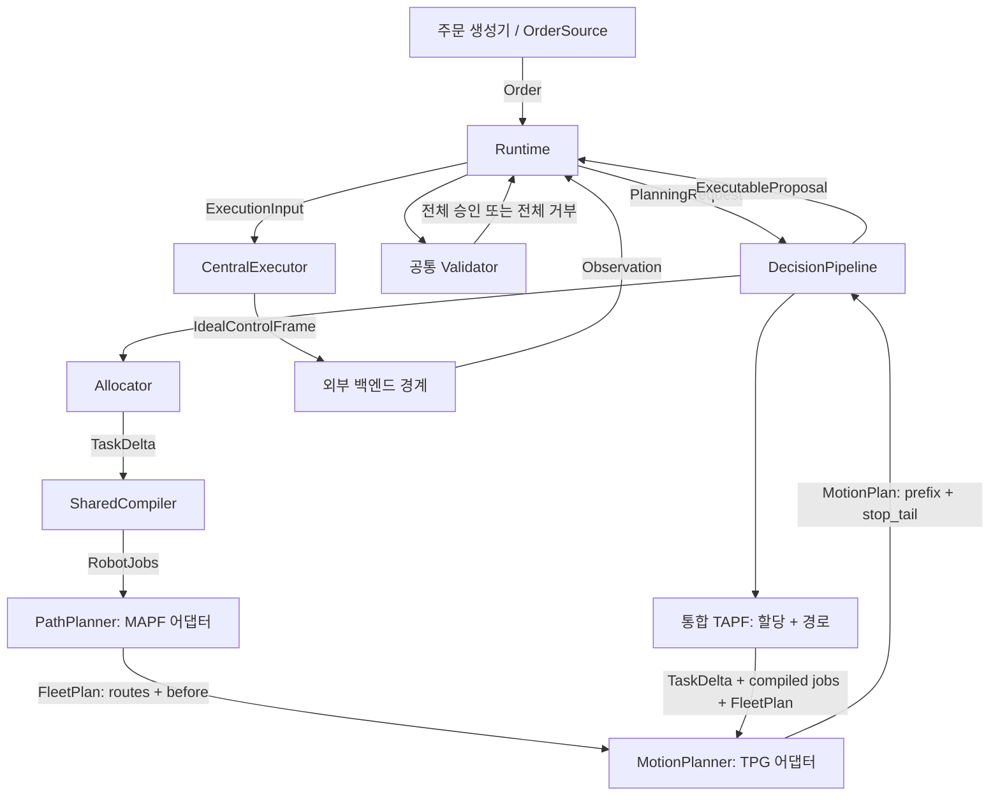

# 개발 계획

[中文](ROADMAP_ZH.md) | [English](ROADMAP.md) | [한국어](ROADMAP_KO.md)

<!-- doc-sync: roadmap / 2026-10-19-r2 -->

상태: PR 1은 공통 계약을 마련한다. 아래 구현 단계는 모두 시작 전이다.
각 단계에 여러 PR이 필요할 수 있다. 각 PR의 코드 변경은 500행 이내이며,
문서와 설정은 제외한다. 사용자가 병합한 후 다음 개발을 시작한다. 세 언어를 동기화한다.

## 교체 가능한 모듈

이 그림은 목표 설계이며 실제 통합 실행을 나타내지 않는다. 백엔드는 이번 범위 밖이다.
테스트는 고정 관측과 테스트 대역을 제공할 수 있다. 생성자 주입으로 구현을 선택한다.
새 알고리즘 때문에 Runtime이나 공개 요청 필드를 변경해서는 안 된다. 네이티브 의존성은 선택 사항으로 둔다.

`DecisionPipeline.solve(PlanningRequest)`가 공통 교체 경계다.
단계별 구현은 할당기, 컴파일러, MAPF, 운동 계획기를 조합한다.
통합 TAPF는 할당과 경로 검색을 함께 교체한 후 같은 컴파일 의미,
운동 어댑터, 검증기, 최종 제출을 사용한다. 운동까지 최적화하는 해결기는 전체 경계를 직접 구현할 수도 있다.
필수 중간 제출 단계를 추가하지 않는다. TAPF가 창고 재고까지 처리한다고 주장하지 않는다.

## 단계별 범위와 검증 증거

| 단계 | 범위 | 구현 완료로 표시하기 전에 필요한 증거 |
| --- | --- | --- |
| 1 | 공통 API 계약, 패키지, review 규칙 | 독립 설치와 가져오기; 원본 해시 |
| 2 | 구조 codec과 선택한 fixture | 왕복 변환; 알 수 없는 필드와 잘못된 값 거부 |
| 3 | 주문 소스와 seed 기반 주문 생성 | 정렬된 발행, SKU 병합, 중복 발행 방지, 시간 역행 거부, reset 재현 |
| 4 | 공통 작업 컴파일러 | 변경 가능한 접미 큐 편집, D1 잠금, 운반 주체, 공통 양자화 시간 |
| 5 | 할당 어댑터 | 재고와 수요의 실행 가능성, 안정적인 작업 ID, 입력 스냅샷 불변 |
| 6 | MAPF 프로세스 어댑터 | 버전 고정 실제 실행 파일, 인접 간선, 반복 자원 방문, 완전한 선후 관계, 시간 초과 |
| 7 | TPG 프로세스 어댑터 | 실제 속도 프로파일, 정확한 연결, 동작 시간, 전체 로봇 정지 꼬리, 미지원 사례 명시 |
| 8 | 단계별 구성과 통합 TAPF | 동일한 지원 fixture에서 독립 할당/MAPF를 CBS-TA로 교체 |
| 9 | 연속 검증기 | 샘플 사이 교차, 추종, 적재 회전, 자원 용량, 무기한 종점 점유 |
| 10 | Runtime 트랜잭션과 분기 | 중복 예약 방지, 멱등 제출, 오래된 결과 거부, Lift 보호, 도래한 분기 우선 |
| 11 | 중앙 실행기와 통합 재현 | 정확한 Hermite 분할, 전환 절점 유지, 동작 단일 시작, 이벤트 중복 제거 |

원본 구현 통합 전에 어댑터가 지원하는 부분집합을 정의하고 테스트한다.
미지원 간선 중간 출발, 적재 인계, 기하, 순환 회전, 동작 의미는 명시적으로 거부한다.
문제를 조용히 단순화하지 않는다. 중간 어댑터 PR이 모든 단계의 실행을 주장할 필요는 없다.
공통 검증기와 정지 요구사항을 충족하기 전에는 실행 가능한 제안을 승인하지 않는다.

## 원본 구현 후보

확인일: 2026-10-19. 연구 후보이며 통합 검증을 완료한 구현이 아니다.

| 후보 | 근거와 제안 역할 | 어댑터 작업 / 한계 |
| --- | --- | --- |
| [MAWPF](https://github.com/HirokiNagai-39/mawpf) | C++17; CLI에서 LaCAM, PIBT, LNS2, PP 선택; MIT | 첫 MAPF 계열. 그래프/상태/작업 변환, 여러 셀 이동 확장, 자원 선후 관계 출력. 창고 동작 지원 여부 확인 필요. |
| [WinkTPG](https://github.com/JingtianYan/WinkTPG-IEEE-TASE) | C++20과 Boost; 경로 파일 입력과 CSV 출력; 모드 1은 WinkTPG, 0은 TPG | 첫 운동 계획 계열. 물리 동작, 정확한 연결, 전체 로봇 정지 검증 추가. 확인한 트리에 라이선스 파일이 없으므로 재배포 전에 사용 조건 확인. |
| [libMultiRobotPlanning](https://github.com/whoenig/libMultiRobotPlanning) | C++14; CBS/ECBS, CBS-TA/ECBS-TA, 최소 비용 할당, 차선 할당 열거; MIT | 할당과 통합 TAPF 실험. 목표 할당 예제에는 SKU 선택, 선반 서비스, 큐 잠금이 없다. |

확인한 commits (빌드 도입 시 다시 고정):

- MAWPF: `0cdb8e43797aff3781e4cd3ddb2c6d7d36f3df17`.
- WinkTPG: `dd96946f225e206de35b041320786eab43210658`.
- libMultiRobotPlanning: `4c75fa20c435c440d8b6bd6dc81668ddc7296ba0`.

할당에서는 실행 가능한 연결을 명시한 최소 비용 로봇/작업 매칭을 먼저 시험한다.
창고 전용 코드는 가능한 선반, 피킹 항목, 작업대, 반환 위치를 선택해야 한다.
매칭만으로 재고와 서비스 순서가 해결되지는 않는다.
로봇당 목표 하나인 제한된 시나리오에서 통합 CBS-TA와 비교한 뒤 여러 동작의 창고 작업으로 확장한다.
이는 제안한 실험이며 CBS-TA가 전체 API를 이미 지원한다는 뜻은 아니다.

## 관측 가능성

모든 실제 통합 실행에서 요청 ID, 입력 fixture, 원본 commit, 명령/설정,
seed, 실제 시간 예산, 종료 상태, 진단, 정규화 결과를 기록한다.
수정과 함께 최소 실패 재현을 보존한다. 할당, 경로 방문/선후 관계, 운동 절점, 정지 결정을 추적한다.
확인할 실제 해결기 출력이 생기면 재현 UI를 추가한다.
fixture 통과와 네이티브 해결기 실행은 따로 표시한다.
