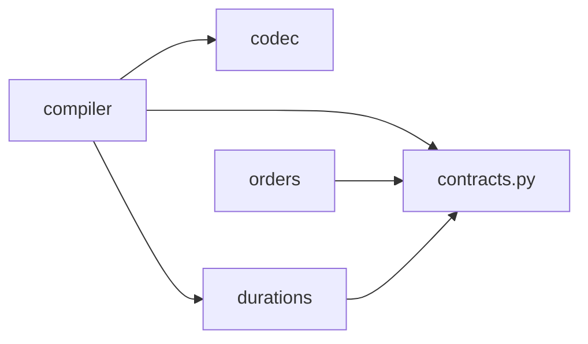

# Module directories and public APIs

[中文](../../zh/architecture/MODULES.md) | [English](../../en/architecture/MODULES.md)

<!-- doc-sync: module-boundaries / 2026-10-20-r1 -->

## Implemented directories

Each module owns its implementation and local validation directory.
`__init__.py` explicitly exports entry points; underscore files are internal.
`contracts.py` remains the sole source of DTOs and Protocols.
Tests are grouped by module; test cases and codec fixtures retain their behavior.

```text
src/warehouse_api/
  contracts.py
  codec/
    __init__.py
    _json.py
    _validation.py
  orders/
    __init__.py
    _replay.py
    _validation.py
  durations/
    __init__.py
    _timing.py
    _validation.py
  compiler/
    __init__.py
    _current_task.py
    _validation.py
tests/
  codec/fixtures/
  compiler/
  durations/
  orders/
  test_module_boundaries.py
```

## Allowed dependencies

Arrows show import dependencies, not execution order. The codec converts generic
structures and does not depend on concrete contracts or business modules.



| Module | Public API | Responsibility |
| --- | --- | --- |
| contracts.py | Existing Request/Result, DTO, Protocol types | Shared communication types, no algorithms |
| orders | ReplayOrderSource, generate_orders | Order release and generation |
| compiler | CurrentTaskCompiler | Compile supported current tasks and new bindings |
| durations | action_duration_s, action_duration_ticks | Shared action timing |
| codec | dumps, loads, from_data, to_data | JSON structure conversion |

Cross-module imports use package entry points or contracts. For example, the
compiler uses `from warehouse_api.durations import action_duration_s`.
Each package's `_validation.py` owns its input or business rules.
The future continuous geometry validator has a separate responsibility from
these local checks.

Composition code selects implementations; consumers use Protocols from contracts.
Existing public imports such as `from warehouse_api.compiler import CurrentTaskCompiler`
remain compatible. Internal Python `__module__` paths change; historical pickle
and internal module imports are not guaranteed compatible. Public JSON contracts
are unchanged. This change adds no runtime orchestrator or complete planning pipeline.

## Future module boundaries

The following interfaces are defined and directories planned; no empty implementation
packages have been created.

| Planned directory | Interface in contracts | Status |
| --- | --- | --- |
| allocation/ | Allocator | Interface defined |
| mapf/ | PathPlanner | Interface defined |
| tpg/ | MotionPlanner | Interface defined |
| planning/ | DecisionPipeline | Composition entry point for staged and joint TAPF defined |
| validation/ | Validator | Continuous validation interface defined |
| runtime/ | Runtime | Transaction and atomic commit interface defined |
| execution/ | CentralExecutor | Execution interface defined |

Modules communicate through public Request/Result types; native objects remain
inside adapters. New modules get separate directories and dependency checks.
Simulator, backend, IPC, and scene assets remain out of scope.

## Verification boundary

`tests/test_module_boundaries.py` checks static imports in actual Python files.
It rejects reverse dependencies, cross-module internal imports, and cross-module
star imports; it also checks public exports. Relative imports and aliases are
covered, both in source and installed wheels. It does not intercept dynamic
imports or runtime attribute access and is not a Python sandbox.
Business fixtures verify existing behavior after refactoring, not real solvers
or execution safety.
