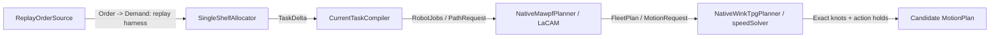

# Real order-to-TPG planning chain

[中文](../../zh/development/0009-staged-pipeline.md) | [English](../../en/development/0009-staged-pipeline.md)

<!-- doc-sync: staged-pipeline / 2026-10-20-r2 -->

## Scope and status

The native planning chain now runs locally: order release -> feasible allocation -> shared compilation -> upstream MAWPF -> upstream WinkTPG -> candidate MotionPlan. No solver test doubles are used in `tests/native/replay.py`.

Supported scope is one robot, one grounded shelf, one demand/stock row, and an eastbound unit-spaced lane. The robot starts at node 0, reaches pickup, station, and a later empty return slot. All headings are zero, all starts are at rest, and obstacles are absent. Unsupported constraints return `UNSUPPORTED`; insufficient stock returns `NO_PLAN`. This is a narrow real integration, not a general warehouse solver or an execution loop.

[PR #9](https://github.com/Requora/TAPF_MAPF_TPG/pull/9) was submitted prematurely with fixture wiring only. After the user's correction, it was converted to draft. The user authorized continuing this same PR after the 500-line exception request. The native implementation is now included in this correction; no limit exception is implied for later PRs. No additional PR or merge was made.

Validation source snapshot: base `a0e14f7` plus local code. Source SHA256 is `1f8a35d1c83eedd502342d7f4d7aba3f82335b846752cea5fdf584e9267c170a`, computed over sorted `.py`, `.cpp`, `.html`, and `.txt` files under src, tests, integrations, excluding __pycache__, with each relative path and a null byte before its bytes. The source hash identifies the tested native implementation independently of later documentation commits.

## Implementation and decisions



All public planning messages still use contracts.py. StagedPipeline injects each independent stage, shares one deadline, checks path/action identity, and retains the actual stage inputs/results in `last_trace`. Only Runtime may accept a candidate; Runtime is not implemented.

SingleShelfAllocator selects the only supported feasible robot/shelf, checks available SKU quantity, and creates picks from the released demand. Task IDs derive from the request ID. It does not reserve stock or optimize matching. Existing tasks, locked queues, and general allocation are unsupported by this allocator.

MAWPF is called for each action target. Its actual states become adjacent Move steps plus compiled Do references. WinkTPG consumes those chosen moves and returns its actual speed primitives for each leg. Each leg ends at rest so the compiled action can run. The adapter retains acceleration switches, including the midpoint of a zero-to-zero triangular primitive, as Hermite knots. It adds stationary time to reach a simulation tick before starting each action. Compiled duration and StepRef are preserved. The already stopped single robot receives an explicit hold tail.

`validation` currently owns supported-subset input/business checks, not the continuous Validator implementation. MAPF and TPG own local native-output validation. `native_process` retains commands, request IDs, budgets, elapsed time, exit codes, stdout, stderr, and raw outputs. TimeoutExpired is the only caught process exception, mapped to TIMEOUT after the child is killed by subprocess.run; unexpected errors keep their traceback. Old output files cannot satisfy a new call.

## Verification and replay

First clone the upstream URLs below and check out their exact commits. CMake verifies commits and rejects tracked source changes. In this environment CMake is in `/home/yimin/miniconda3/envs/lacam-tapf/bin`; Boost 1.85.0 and GCC 13.3.0 were used. Upstream sources remain outside this repository.

```bash
cmake -S integrations/native -B /tmp/tapf-chain-bridges \
  -DMAWPF_SOURCE_DIR=/tmp/tapf-chain-mawpf \
  -DWINKTPG_SOURCE_DIR=/tmp/tapf-chain-winktpg \
  -DCMAKE_PREFIX_PATH=/home/yimin/miniconda3/envs/lacam-tapf
cmake --build /tmp/tapf-chain-bridges -j 4
WAREHOUSE_NATIVE_BIN=/tmp/tapf-chain-bridges PYTHONPATH=src python -m unittest discover -s tests -v
PYTHONPATH=src:tests python -m native.replay /tmp/tapf-chain-bridges \
  --output /tmp/tapf-real-chain.json --html /tmp/tapf-real-chain.html
PYTHONPATH=src:tests python -m native.replay /tmp/tapf-chain-bridges \
  --quantity 3 --stock 3 --station 4 --destination 8 \
  --output /tmp/tapf-real-chain-changed.json --html /tmp/tapf-real-chain-changed.html
PYTHONPATH=src:tests python -m native.replay /tmp/tapf-chain-bridges --stock 0 \
  --output /tmp/tapf-real-chain-rejected.json --html /tmp/tapf-real-chain-rejected.html
ruff check src tests web/progress/check.py
```

Observed: 79 source tests and 79 clean installed-wheel tests pass with real binaries enabled. Ruff, pip check, and diff checks pass. Without WAREHOUSE_NATIVE_BIN the three native-chain tests are explicitly skipped. Native binaries remain optional package dependencies. A separate native CI job builds the pinned upstreams and uploads the real JSON/HTML replay. Its remote execution is pending at this commit.

| Replay | Actual result |
| --- | --- |
| One unit, pickup 1, station 3, return 5 | Six successful native process calls; Lift at 2.0 s, Serve at 5.2 s, Drop at 8.4 s; completion 8.7 s; terminal speed zero |
| Three units, station 4, return 8 | Actual native path changes; service duration 0.7 s instead of 0.3 s; starts 2.0/5.9/10.7 s; completion 11.0 s |
| Stock zero | NO_PLAN at allocation; no native calls |
| Second robot | UNSUPPORTED |
| Real sleeping subprocess | TIMEOUT recorded; no successful result consumed |
| Exit zero without output | BACKEND_ERROR; stale output was removed |

Tests analytically check Hermite speed and acceleration extrema on every interval of the default replay, exact action holds, reference order, tick alignment, end pose, zero terminal speed, and tail splice. These checks are not continuous collision or indefinite parking validation. Input snapshots remain unchanged. JSON evidence contains executable SHA256 values, actual stage outputs, and the complete raw native records.

The standalone HTML replay uses the returned Hermite knots, not sampled invented paths. It supports time scrubbing, previous/next knots, playback, action/resource inspection, native output expansion, and a rejection view. Browser QA passed six-call and action-table checks, step control, terminal speed, mobile overflow, and rejection display. Desktop/mobile screenshots were inspected. The moving shelf illustration is derived from scheduled action completion, not backend observations.

## Upstream provenance and failures

| Source | Commit | License / integration |
| --- | --- | --- |
| [MAWPF](https://github.com/HirokiNagai-39/mawpf) | `0cdb8e43797aff3781e4cd3ddb2c6d7d36f3df17` | MIT; actual LaCAM routes exported by a thin wrapper |
| [WinkTPG](https://github.com/JingtianYan/WinkTPG-IEEE-TASE) | `dd96946f225e206de35b041320786eab43210658` | No license file found; no upstream source/binaries redistributed; actual speedSolver primitives exported |

The MAWPF stock scenario loader returned `invalid N` because its U indexing omits the omega dimension. The wrapper selects the correct zero-speed/east-facing vertices by their explicit attributes and sets the borrowed graph's ownership flag, which that upstream constructor leaves uninitialized. No search algorithm was rewritten.

WinkTPG originally failed to compile because simulator.h lacks unordered_map; the build adds `-include unordered_map`. Its CLI CSV is statistics, so the wrapper calls speedSolver and exports start time, cost, and start/end speeds directly. An initial infinite planning horizon overflowed an upstream integer bound; the wrapper now uses the finite path length. The upstream simEnv is only an initial-state container: no simulator step or new simulator/backend implementation was added.

Historical fixture-only validation passed 73 tests at `4277591`. An earlier dirty-workspace wheel included obsolete flat modules; clean export `c47f4a7` passed the then-current 72 tests. The native wheel was built from a new source-only directory. These historical counts are distinct from the current 79-test native run.

## Unverified boundaries and handoff

Multi-robot conflicts/precedence, turns, obstacles, moving splices, accepted task progress, reassignment, joint TAPF, Runtime transactions, continuous geometry, infinite parking occupancy, central execution, and physical backend operation remain unverified or unimplemented. The adapter explicitly rejects unsupported inputs. Its MotionPlan is a candidate, not Accepted.

PR #9 remains draft while remote native CI is checked. The user approved the one-PR line-limit exception. At submission, code changes total 1,192 lines (+1,143/-49); docs and configuration are disclosed separately at handoff. The previous private website version documents the earlier fixture snapshot, not this new run. Local HTML/JSON artifacts above are the current native evidence.
