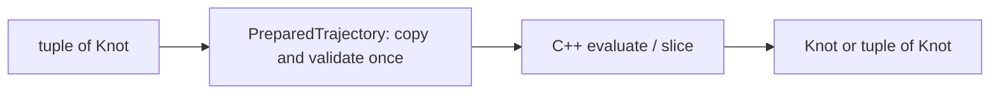

# Single trajectory preparation and query path

[中文](../../zh/development/0016-single-trajectory-path.md) | [English](../../en/development/0016-single-trajectory-path.md)

<!-- doc-sync: single-trajectory-path / 2026-11-15-r1 -->

## Scope and baseline

GitHub confirms PR #14 merged at `a6cdd31ca2d27e522efa6f9773b1db5da5898092`. After updating origin/main, this work starts on independent branch `refactor/single-trajectory-path`. The current change is [PR #16](https://github.com/Requora/TAPF_MAPF_TPG/pull/16), awaiting review. The user requires one way to perform each task, without compatibility switches.

This update cleans up only shared trajectories and their callers. The C++ Hermite core, centralized validation, shared contracts and upstream versions are unchanged. Python only converts between shared contracts and native data. Runtime, continuous validation and execution remain unimplemented.

## Removed and retained code

The evaluate / slice_curve tuple auto-conversion is removed; inputs are now PreparedTrajectory only. The benchmark prepared parameter, --prepared option and prepared mode field are removed. Each trajectory creates one native snapshot before repeated queries. Native replay and tests construct snapshots explicitly.

Tuples of Knot remain snapshot-construction input and slice output: data representations rather than a second computation path. Python contract conversion, independent analytic tests, browser replay and historical performance records retain their API-boundary, validation and evidence-display roles. PR #14 already removed the old Python interpolator and temporary C++ comparison program. Local untracked setuptools build output and obsolete Python validation bytecode were also removed; these are outside the PR source diff.

This update also records the single production implementation/path rule in root AGENTS.md so later work cannot reintroduce old implementations, fallbacks or mode switches. Root AGENTS.md remains Chinese-only as required by the repository.

## Single call chain



```python
from warehouse_api.trajectory import PreparedTrajectory, evaluate, slice_curve
snapshot = PreparedTrajectory(knots)
state = evaluate(snapshot, time_s)
section = slice_curve(snapshot, start_s, end_s)
```

Querying a sliced result requires creating its snapshot first. Queries never rebuild snapshots automatically. No Python computation fallback or mode selection is provided.

## Validation and failures

TDD: the benchmark test first required one preparation per curve; the old path returned `0 != 2`, confirming failure (`/tmp/single-trajectory-red.log`). It passes after branch removal. Tests also require evidence without a prepared mode field and reject the removed --prepared argument.

```bash
WAREHOUSE_NATIVE_BIN=/tmp/tapf-chain-bridges /tmp/trajectory-cpp-dev/bin/python -m unittest discover -s tests -v
PYTHONPATH=tests /tmp/trajectory-cpp-dev/bin/python -m trajectory.replay /tmp/tapf-chain-bridges --output /tmp/single-trajectory-native.json
PYTHONPATH=tests /tmp/trajectory-cpp-dev/bin/python -m trajectory.benchmark --robots 1 100 --knots 16 128 --hz 50 --frames 1 --repeats 1 --output /tmp/single-trajectory-benchmark.json
```

Source tests: 107 total, 106 pass, one optional CBS-TA skip (`/tmp/single-trajectory-green.log`). Real MAWPF/WinkTPG replay compares 36 original/slice states with maximum x/vx error 1.67e-15. The benchmark completes eight cases without a mode flag; raw JSON records snapshot preparation and query timing. This small sample verifies execution only and does not update historical performance conclusions. It proves no continuous geometry or parking safety.

Current clean sdist -> wheel isolated tests report 107 tests, 106 passing and one skip; pip check and Ruff pass. Real replay using the installed wheel still gives 36 comparisons with maximum x/vx error 1.67e-15. Wheel inspection confirms it contains neither the retired Python trajectory validator nor the stale codec module. Bilingual browser, both architecture diagrams, keyboard and mobile checks pass; private publication will be recorded below.

## PR and next work

This minimal PR is submitted and awaits review without starting the next stage. Other platforms, full real-time execution, continuous safety and consumer integration remain unverified.

Final status: [PR #16](https://github.com/Requora/TAPF_MAPF_TPG/pull/16) awaits review. Independent gpt-6-luna/low documentation review passes after correcting a leading space in the Chinese paragraph. Desktop and mobile screenshots were inspected. Private progress publication succeeded: source `1ec1496a78a93acd7b1855bc3a2865953424618e`, version `appgprj_6ad6c9324f348191aab84e8bfffe6102~appgver_d3734856fb208191a8aad3afb586aa79`. Owner-only access is unchanged; hosted login remains unverified. The full PR against `a6cdd31` has 106 code lines including tests/web and 171 documentation lines including root AGENTS.md, with no configuration or license changes. New remote CI remains pending confirmation; do not merge automatically.
