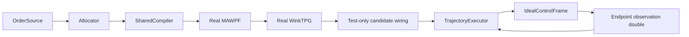

# Executor and orders-to-frames replay

[中文](../../zh/development/0018-executor-replay.md) | [English](../../en/development/0018-executor-replay.md)

<!-- doc-sync: executor-replay / 2026-11-16-r2 -->

## Scope and sources

PR #17 is confirmed merged at `08da31c442a79fa1d377c7b69cebeb72f992e67a`; branch `feat/executor-replay` starts from that baseline. The user now prioritizes demonstrating end-to-end execution soon. This PR records that preference in AGENTS.md, the roadmap and logs, then connects the existing native planning chain to a new central executor.

Specification: user-supplied API 0.7 Section 10 and English type descriptions. Upstreams remain MAWPF `0cdb8e43797aff3781e4cd3ddb2c6d7d36f3df17` and WinkTPG `dd96946f225e206de35b041320786eab43210658`; URLs, licenses and builds are recorded in the [native chain log](0009-staged-pipeline.md). No native-code change or WinkTPG source redistribution.

## Implementation and boundaries

`execution.TrajectoryExecutor` implements CentralExecutor.build_frame from the shared contracts. Inputs are ExecutionInput and dt_s; output is IdealControlFrame or Failure. New dependencies are execution -> contracts, execution -> trajectory and execution -> validation, reflected in the architecture guard. Neither backend nor Runtime is implemented.

The executor reuses PreparedTrajectory, evaluate and slice_curve, caching snapshots for current curves without another interpolation implementation or replanning. Frames retain endpoints and internal knots; stopped endpoints may hold indefinitely. Execution-boundary checks stay in execution/_validation.py and reuse public validation.check_motion_curve, which also serves stopping-structure checks. Missing robots, duplicate IDs, non-finite knots/times, empty curves, unordered times, moving-endpoint extrapolation and state mismatches are rejected.

Step references resolve through the accepted action table. Only current-tick starts that are not running are emitted. Unknown/duplicate references, invalid durations, midframe starts, multiple starts per robot and a different start on a busy robot are rejected. Action-clock comparison allows min(1 ns, dt_s * 1e-6) for accumulated floating-point error; pose and velocity joins remain exact. The executor commits no state. Callers dispatch one returned frame per tick; rebuilding a frame does not imply backend deduplication.



Real-run evidence covers one robot/shelf on an eastbound lane. The observation double only echoes frame-end poses and velocities. It produces no completion events, shelf changes or ledger updates. Candidate wiring exists only in the test driver and cannot authorize production acceptance. Runtime acceptance, action completion, shelf effects, ledger updates, backends, continuous collision and indefinite parking safety remain unverified. This is not a complete warehouse order-fulfillment loop.

## Actual replay and verification

The real run produces 91 frames from 0.0 to about 9.1 s. Lift, Serve and Drop each start once, at approximately 2.0, 5.2 and 8.4 s. The robot ends at x=5 m with zero velocity and continues sending stopped holds. JSON retains every input state/frame, starts, native files, binary SHA256 and upstream versions. HTML displays the same JSON as stepwise positions, internal knots and actions.

```bash
PYTHONPATH=src:tests /tmp/trajectory-cpp-dev/bin/python -m execution.replay /tmp/tapf-chain-bridges --output /tmp/executor-native.json --html /tmp/executor-native.html
PYTHONPATH=src WAREHOUSE_NATIVE_BIN=/tmp/tapf-chain-bridges /tmp/trajectory-cpp-dev/bin/python -m unittest discover -s tests -q
/tmp/warehouse-ci-check/bin/ruff check src tests
```

TDD began with the absent TrajectoryExecutor import failing. Ten executor tests and one real-replay test pass. Full suite: 124 tests, 123 pass, one optional CBS-TA skip. Ruff and diff checks pass. CI adds execution.json/html artifacts; remote results are pending.

Failure record: the first real replay rejected tick=3 because the double rounded time independently of the curve endpoint; it now uses the returned frame's to_s. Another regression initially reported action count `0 != 1`, exposing `0.1 + 0.2` versus `0.3` clock equality; explicit small clock tolerance fixes it without relaxing pose checks. The first browser script failed with builtin append as an event callback; an explicit callback fixed it. Mobile action JSON overflowed; short wrapping action labels replace it while raw data remains in details.

## PR and next step

Current [PR #18](https://github.com/Requora/TAPF_MAPF_TPG/pull/18) awaits review. Only address this PR's review before merge. Select the next minimal loop gap according to the user's end-to-end priority; no Runtime or backend implementation in this PR. The private dashboard and actual replay will be published together with access preserved.

Additional verification: rebuilding a wheel in clean directory `/tmp/executor-wheel-ro4ojnsr` and installing it passes 124 isolated tests, 123 pass and one skip; pip check passes. Native executables reuse existing pinned binaries, with SHA256 in JSON; no fresh upstream build is claimed. Dashboard and replay pass desktop, mobile and keyboard checks; screenshots inspected. The dashboard links to the [actual stepwise replay](https://warehouse-planning-observatory.gain-salvo-0t.chatgpt.site/execution-replay.html). Publication adds this generated HTML evidence to the independent Sites checkout; its source template is reviewed at tests/execution/replay.html, without treating generated data as another algorithm implementation.

Final status: independent gpt-6-luna/low bilingual review passed, with old 0017 review status marked historical. Private dashboard and actual stepwise replay publication through the Sites skill succeeded from source `d920a31c638a7c522e8486c51a920b2c7c910133`, version `appgprj_6ad6c9324f348191aab84e8bfffe6102~appgver_ca13e26603788191b3a4e3e0a8387cdd`. Owner-only access is preserved. Hosted sign-in and new remote CI remain unverified. Current PR awaits review; no automatic merge or subsequent implementation.

Review-rule update: the user requires bilingual Chinese-first PR titles and descriptions with matching structure, facts and verification status, opening with what changes, why it matters now and its concrete connection to demonstrating end-to-end execution soon, followed by implementation and verification. AGENTS.md records this rule and PR #18 is rewritten accordingly.

Review corrections: both findings are accepted. Regressions first confirmed that skipping a start returned a normal frame rather than BAD_ACTION and rebuilding equal knot tuples prepared twice instead of once. The executor now retains returned-start references for the active plan; past actions without output history or a running record return BAD_ACTION. A fresh instance resuming historical schedules also rejects unproven past starts rather than guessing completion. History is bounded to active-plan references and does not prove backend receipt; callers still dispatch only one frame per tick. Cache lookup now compares knot values, reusing snapshots for equal reconstructed tuples without another implementation path. Real replay remains 91 frames and 3 starts.

Presentation correction: following user feedback, replay now tells a playable pickup -> station service -> return-and-stop story, labeling the three actual command locations and issued status in Chinese and English. Raw evidence is collapsed, and neither animation nor issued commands are labeled as completed shelf handling.

User-review correction: build_frame now calls prepare_frame once; all input rules, curve coverage and state-join failures are handled in the separate validation file. The main method forwards Failure, slices and assembles output. The repository audit covers 36 production Python files: input/business checks reside in validation modules. Existing planning budget expiry and native_process timeout, exit-code and missing-output classification remain runtime-result handling and were not migrated here; this does not claim every error constructor has left main functions. The review reply discloses that distinction. AGENTS.md now requires stage-boundary validation through one aggregate call.
