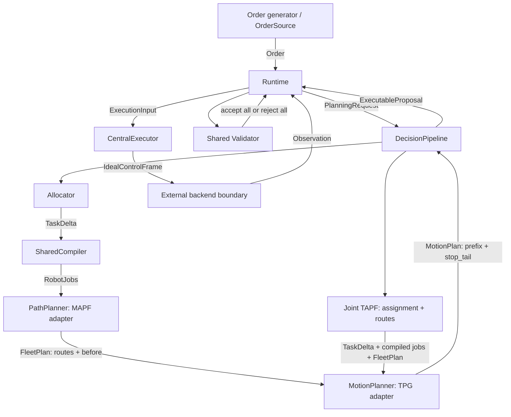

# Development roadmap

[中文](../../zh/development/ROADMAP.md) | [English](../../en/development/ROADMAP.md)

<!-- doc-sync: roadmap / 2026-10-23-r27 -->

Status: PR #13 is merged at `cabdac3`; C++ trajectory PR #14 remains under review. Current work independently repairs OpenRouter review transport: one attempt, explicit upstream errors, provider filtering and bounded runtime. Six transport tests pass; remote review verification is pending. See [review transport](0015-review-transport.md). Runtime, execution and continuous safety remain incomplete.

## Replaceable modules

The diagram describes the full target design. Its single-lane planning subset runs locally; the full loop does not. The backend
is external to this work. Tests may supply fixed observations and test doubles.
Constructor injection selects implementations. New algorithms must not require
changing Runtime or public request fields. Keep native dependencies optional.

`DecisionPipeline.solve(PlanningRequest)` is the common replacement boundary.
A staged implementation composes allocator, compiler, MAPF, and motion planner.
A joint TAPF implementation replaces assignment and route search together, then
uses the same compiler semantics, motion adapter, validator, and final submit.
A solver that also optimizes motion may implement the entire boundary directly.
Do not add a mandatory intermediate submit or claim TAPF covers warehouse stock.

## Incremental stages and acceptance evidence

| Stage | Scope | Required evidence before calling it implemented |
| --- | --- | --- |
| 1 | Shared API contracts, package, review rules | Standalone install and imports; source hash |
| 2 | Shape codec and selected fixtures | Round trips, unknown fields and invalid values rejected |
| 3 | Order source and seeded order generation | Sorted releases, merged SKUs, no duplicate release, backward-time rejection, reset replay |
| 4 | Shared task compiler | Remaining actions of the current task, D1 locks, carry ownership, shared quantized durations; defer queue suffix edits |
| 5 | Assignment adapter | Stock and demand feasibility, stable task IDs, unchanged input snapshots |
| 6 | MAPF process adapter | Real pinned executable, adjacent edges, repeated resource visits, complete precedence, timeouts |
| 7 | TPG process adapter | Real profiles, exact splices, action durations, fleet stop tail, explicit unsupported cases |
| 8 | Staged and joint TAPF composition | Replace standalone assignment/MAPF with CBS-TA on the same supported fixture |
| 9 | Continuous validator | Crossing between samples, following, turning loads, resource capacities, indefinite terminal holds |
| 10 | Runtime transactions and branches | No double reservation, idempotent submit, stale rejection, protected Lift, due branch wins |
| 11 | Central executor and integrated replay | Exact Hermite slices, retained switch knots, action starts once, event deduplication |

Before extending upstream integration, define and test the adapter's supported subset.
Refuse unsupported mid-edge starts, loaded handovers, geometry, cyclic rotations,
or action semantics rather than silently reducing the problem. An intermediate
adapter PR need not claim all stages work; no executable plan is accepted until
the shared validator and stopping requirements are satisfied.

## Candidate upstreams

Inspected on 2026-10-20. MAWPF/WinkTPG have single-lane integration evidence; libMultiRobotPlanning has a real goal-assignment experiment. General warehouse support remains incomplete.

| Candidate | Evidence and proposed role | Adapter work / limits |
| --- | --- | --- |
| [MAWPF](https://github.com/HirokiNagai-39/mawpf) | C++17; CLI selects LaCAM, PIBT, LNS2, or PP; MIT | Single-lane graph/state/job translation and action capability checks run locally. Multi-robot paths, obstacles, turns, multi-cell moves and resource precedence remain incomplete. |
| [WinkTPG](https://github.com/JingtianYan/WinkTPG-IEEE-TASE) | C++20 and Boost; path file to CSV; modes 1 (WinkTPG) and 0 (TPG) | Single-lane physical actions and exact Hermite splices run locally. Multi-robot motion and continuous fleet stopping checks remain incomplete. No license file found in the inspected tree; resolve reuse terms before redistribution. |
| [libMultiRobotPlanning](https://github.com/whoenig/libMultiRobotPlanning) | C++14; CBS/ECBS, CBS-TA/ECBS-TA, min-cost assignment and next-best assignment; MIT | Real assignment, CBS and CBS-TA comparison completed. Its goal-assignment examples do not express SKU selection, shelf service or queue locks. |

Inspected commits (each native build pins its upstream):

- MAWPF: `0cdb8e43797aff3781e4cd3ddb2c6d7d36f3df17`.
- WinkTPG: `dd96946f225e206de35b041320786eab43210658`.
- libMultiRobotPlanning: `4c75fa20c435c440d8b6bd6dc81668ddc7296ba0`.

For assignment, first test min-cost robot/job matching with explicit feasible
edges. Warehouse-specific code must select feasible shelves, picks, stations
and return slots; matching alone does not solve inventory or service sequencing.
The restricted two-robot, one-goal-per-robot experiment is complete, including assignment ties and a passing-bay detour.
Shared task semantics and multi-action warehouse adaptation remain future work; CBS-TA does not support the full warehouse API.

Stage 8 has a verified single-lane staged chain and an isolated native goal-assignment experiment. The joint warehouse pipeline and general native integration remain planned.

## Observability

Every real integration run must record request ID, input fixture, upstream
commit, command/configuration, seed, wall-time budget, exit status, diagnostics,
and normalized result. Preserve a minimal failure replay alongside its fix.
Show assignment, route visits/precedence, motion knots and stopping decisions
in traces. A replay UI is added when there is actual solver output to inspect.
Fixture passes must remain labeled separately from native solver runs.
