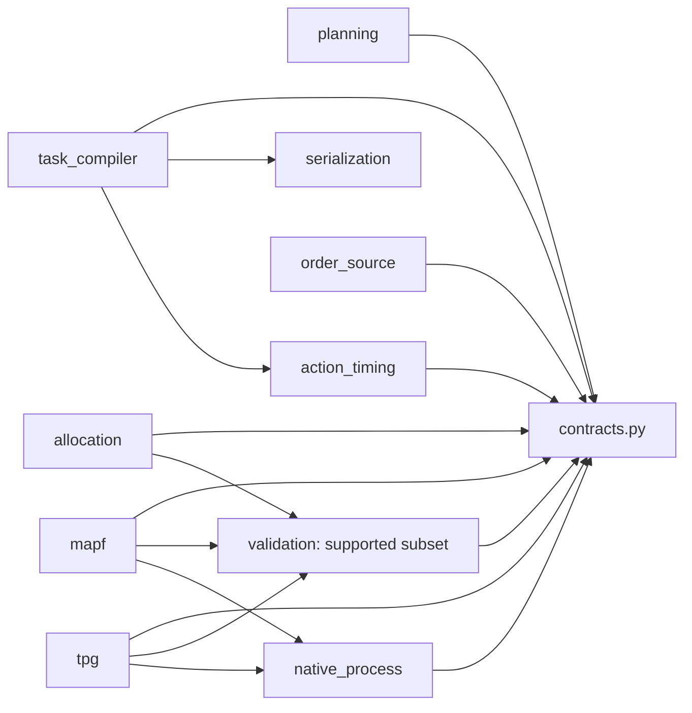

# 模块目录与公开 API

[中文](../../zh/architecture/MODULES.md) | [English](../../en/architecture/MODULES.md)

<!-- doc-sync: module-boundaries / 2026-10-23-r9 -->

[交互架构与进展网页](https://warehouse-planning-observatory.gain-salvo-0t.chatgpt.site).

私有网页同步 PR #11 合并基线 `5e35ee0` 与模块组合测试进展, 保留原生证据和未完成边界.

## 已实现目录

每个模块的实现和本地校验放在自己的目录中. `__init__.py` 显式公开入口,
下划线文件属于内部实现. `contracts.py` 保持唯一 DTO 和 Protocol 来源.
测试按模块分目录, 测试用例和 serialization fixture 保持原有行为.

```text
src/warehouse_api/
  contracts.py
  serialization/
    __init__.py
    _json.py
    _validation.py
  order_source/
    __init__.py
    _replay.py
    _validation.py
  action_timing/
    __init__.py
    _timing.py
    _validation.py
  allocation/
    __init__.py
    _single_shelf.py
  mapf/
    __init__.py
    _mawpf.py
    _validation.py
  tpg/
    __init__.py
    _winktpg.py
    _validation.py
  validation/
    __init__.py
    _single_lane.py
  native_process/
    __init__.py
    _run.py
  planning/
    __init__.py
    _staged.py
    _validation.py
  task_compiler/
    __init__.py
    _current_task.py
    _validation.py
tests/
  composition/
  native/
  native_process/
  planning/
  serialization/fixtures/
  task_compiler/
  action_timing/
  order_source/
  test_module_boundaries.py
```

## 允许的依赖

箭头表示导入依赖, 不是运行时执行顺序. serialization 是通用结构转换器,
不依赖具体契约或业务模块.



| 模块 | 公开 API | 职责 |
| --- | --- | --- |
| contracts.py | 现有 Request/Result, DTO, Protocol | 统一通信类型, 无算法实现 |
| order_source | ReplayOrderSource, generate_orders | 发布和生成订单 |
| task_compiler | CurrentTaskCompiler | 编译受支持的当前任务和新绑定 |
| action_timing | action_duration_s, action_duration_ticks | 共用动作耗时 |
| planning | StagedPipeline | 共用预算组合注入的阶段并记录真实 trace; 原生单车道链路已本地验证 |
| allocation | SingleShelfAllocator | 唯一可行货架/机器人; 从需求生成 Pick |
| mapf | NativeMawpfPlanner | 固定版本 LaCAM 输出转为相邻移动和动作引用 |
| tpg | NativeWinkTpgPlanner | 固定版本 speedSolver 原语转为 Hermite 节点和动作静止段 |
| validation | check_single_lane, check_jobs, check_assignment | 支持范围检查; 连续 Validator 未实现 |
| native_process | run_native | 进程预算与原始证据保留 |
| serialization | dumps, loads, from_data, to_data | JSON 结构转换 |

跨模块只从包入口或 contracts 导入. 例如编译器调用
`from warehouse_api.action_timing import action_duration_s`.
各包内的 `_validation.py` 负责该模块的输入或业务规则.
后续连续几何验证器有独立职责, 不与这些局部校验混为一体.

组装代码选择实现, 消费者使用 contracts 中的 Protocol.
公开入口使用明确的职责名称, 如 `from warehouse_api.task_compiler import CurrentTaskCompiler`.
旧包导入需要按下表迁移, 不保留旧名称别名. 类名和函数名不变.
内部 Python `__module__` 路径已改变; 不保证历史 pickle 或内部模块导入兼容.
公开 JSON 契约不变. StagedPipeline 已组合四个注入阶段. 原生重放在受支持单位车道使用真实分配, MAWPF 和 WinkTPG. 旧 fixture 重放保留为组合测试. 未实现 Runtime 接受. 见 [组合验证](../development/0009-staged-pipeline.md).


| 旧名称 | 新名称 |
| --- | --- |
| `codec` | `serialization` |
| `compiler` | `task_compiler` |
| `durations` | `action_timing` |
| `orders` | `order_source` |

## 后续模块边界

以下仅为接口已定义和目录规划, 尚未创建空实现包.

| 计划目录 | contracts 中的接口 | 状态 |
| --- | --- | --- |
| validation/ | Validator | 输入范围检查已实现; 连续验证仅接口 |
| runtime/ | Runtime | 事务与原子提交接口已定义 |
| execution/ | CentralExecutor | 执行接口已定义 |

模块使用公开 Request/Result 通信, 原生对象留在适配器内部.
新模块独立建目录并更新依赖检查. 当前不实现模拟器, 后端, IPC 或场景资产.

## 验证边界

`tests/test_module_boundaries.py` 检查实际 Python 文件的静态导入,
拒绝反向依赖, 跨模块内部导入和跨模块星号导入; 同时验证公开导出.
检查覆盖相对导入及别名, 在源码和安装后的 wheel 中均运行.
它不拦截动态导入或运行时属性访问, 也不是 Python 沙箱.
原生测试运行真实上游并解析检查 Hermite 运动学界限, 不证明连续碰撞或无限期停车安全. PR #9 已合并至 `04d4cda`.

## 联合目标分配实验边界

`tests/tapf/` 和 `integrations/tapf/` 运行固定版本 libMultiRobotPlanning 的 assignment, CBS 与 CBS-TA. 实验复用 `native_process.run_native`, 不新增生产模块或模块依赖. 两台点机器人在同一格图上的目标分配总代价为 6/8, 联合结果为 6.

实验 JSON 是研究证据, 不作为新的公共 DTO, 不返回 ExecutableProposal. 目标业务图中的联合 TAPF 连接仍为计划. SKU, Lift/Serve/Drop, 共享编译器, TPG, Runtime 和连续安全尚未接入该实验. 见 [开发记录与真实重放](../development/0010-native-tapf-comparison.md).

## 模块边界组合测试

`tests/composition/` 在测试层选择分配, 编译, MAPF, TPG 的入口与出口, 覆盖四个同模块和六个跨模块连续组合. 中间入口使用独立构造的公开契约数据, 不要求先运行前置模块. 真实模块输出按任务, 动作, 路线和运动约束检查, 不只比较调用顺序. 该驱动不是生产流水线, 不执行 Runtime 提交或总预算管理. 没有新增 joint 模块, 生产 API 和依赖不变.

见 [组合测试与重放](../development/0012-module-composition.md).
