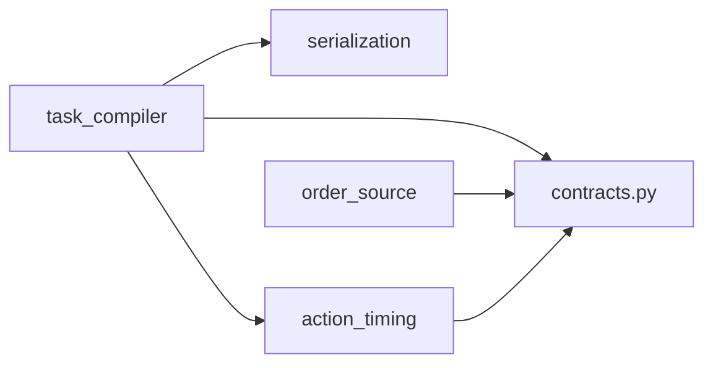

# 模块目录与公开 API

[中文](../../zh/architecture/MODULES.md) | [English](../../en/architecture/MODULES.md)

<!-- doc-sync: module-boundaries / 2026-10-20-r2 -->

## 已实现目录

每个模块的实现和本地校验放在自己的目录中. `__init__.py` 显式公开入口,
下划线文件属于内部实现. `contracts.py` 保持唯一 DTO 和 Protocol 来源.
测试按模块分目录, 测试用例和 serialization fixture 保持原有行为.

```text
src/warehouse_api/
  contracts.py
  serialization/
    __init__.py
    _json.py
    _validation.py
  order_source/
    __init__.py
    _replay.py
    _validation.py
  action_timing/
    __init__.py
    _timing.py
    _validation.py
  task_compiler/
    __init__.py
    _current_task.py
    _validation.py
tests/
  serialization/fixtures/
  task_compiler/
  action_timing/
  order_source/
  test_module_boundaries.py
```

## 允许的依赖

箭头表示导入依赖, 不是运行时执行顺序. serialization 是通用结构转换器,
不依赖具体契约或业务模块.



| 模块 | 公开 API | 职责 |
| --- | --- | --- |
| contracts.py | 现有 Request/Result, DTO, Protocol | 统一通信类型, 无算法实现 |
| order_source | ReplayOrderSource, generate_orders | 发布和生成订单 |
| task_compiler | CurrentTaskCompiler | 编译受支持的当前任务和新绑定 |
| action_timing | action_duration_s, action_duration_ticks | 共用动作耗时 |
| serialization | dumps, loads, from_data, to_data | JSON 结构转换 |

跨模块只从包入口或 contracts 导入. 例如编译器调用
`from warehouse_api.action_timing import action_duration_s`.
各包内的 `_validation.py` 负责该模块的输入或业务规则.
后续连续几何验证器有独立职责, 不与这些局部校验混为一体.

组装代码选择实现, 消费者使用 contracts 中的 Protocol.
公开入口使用明确的职责名称, 如 `from warehouse_api.task_compiler import CurrentTaskCompiler`.
旧包导入需要按下表迁移, 不保留旧名称别名. 类名和函数名不变.
内部 Python `__module__` 路径已改变; 不保证历史 pickle 或内部模块导入兼容.
公开 JSON 契约不变. 本轮没有新增运行时编排器或完整规划链.


| 旧名称 | 新名称 |
| --- | --- |
| `codec` | `serialization` |
| `compiler` | `task_compiler` |
| `durations` | `action_timing` |
| `orders` | `order_source` |

## 后续模块边界

以下仅为接口已定义和目录规划, 尚未创建空实现包.

| 计划目录 | contracts 中的接口 | 状态 |
| --- | --- | --- |
| allocation/ | Allocator | 接口已定义 |
| mapf/ | PathPlanner | 接口已定义 |
| tpg/ | MotionPlanner | 接口已定义 |
| planning/ | DecisionPipeline | 分阶段与联合 TAPF 的组合入口已定义 |
| validation/ | Validator | 连续验证接口已定义 |
| runtime/ | Runtime | 事务与原子提交接口已定义 |
| execution/ | CentralExecutor | 执行接口已定义 |

模块使用公开 Request/Result 通信, 原生对象留在适配器内部.
新模块独立建目录并更新依赖检查. 当前不实现模拟器, 后端, IPC 或场景资产.

## 验证边界

`tests/test_module_boundaries.py` 检查实际 Python 文件的静态导入,
拒绝反向依赖, 跨模块内部导入和跨模块星号导入; 同时验证公开导出.
检查覆盖相对导入及别名, 在源码和安装后的 wheel 中均运行.
它不拦截动态导入或运行时属性访问, 也不是 Python 沙箱.
业务 fixture 证明重构后的已有行为, 不证明真实求解器或执行安全.
