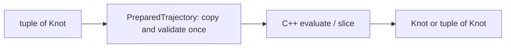

# 单一轨迹准备与查询路径

[中文](../../zh/development/0016-single-trajectory-path.md) | [English](../../en/development/0016-single-trajectory-path.md)

<!-- doc-sync: single-trajectory-path / 2026-11-15-r1 -->

## 范围与基线

已从 GitHub 确认 PR #14 合并至 `a6cdd31ca2d27e522efa6f9773b1db5da5898092`, 并更新 origin/main 后建立独立分支 `refactor/single-trajectory-path`. 当前为 [PR #16](https://github.com/Requora/TAPF_MAPF_TPG/pull/16), 等待 review. 用户要求只保留一种完成同一任务的方式, 不保留兼容开关.

本次只清理共享轨迹模块及调用方. C++ Hermite 核心, 集中校验, 统一契约和上游版本均未改变. Python 仅负责统一契约和原生数据间的转换. 不实现 Runtime, 连续验证器或执行器.

## 删除与保留

删除 evaluate / slice_curve 的 tuple 自动转换, 输入现在仅为 PreparedTrajectory. 删除基准的 prepared 参数, --prepared 选项及结果中的 prepared 模式字段. 每条轨迹只创建一个原生快照, 随后重复查询. 原生重放和测试均显式构造快照.

保留 tuple[Knot, ...] 作为快照构造输入及切片结果, 这是数据表示而非第二种计算方式. 保留 Python 契约转换, 独立解析测试, 浏览器重放及历史性能记录, 它们分别承担 API 边界, 校验和证据展示职责. 旧 Python 插值与临时 C++ 对照程序在 PR #14 中已删除. 本地额外删除了未跟踪的 setuptools build 目录和失效 Python 校验字节码; 它们不计入 PR 源码改动.

本次同步将单一生产实现和调用路径要求写入根 AGENTS.md, 防止后续重新引入旧实现, 回退或模式开关. 根 AGENTS.md 按项目约定只保留中文.

## 唯一调用链



```python
from warehouse_api.trajectory import PreparedTrajectory, evaluate, slice_curve
snapshot = PreparedTrajectory(knots)
state = evaluate(snapshot, time_s)
section = slice_curve(snapshot, start_s, end_s)
```

后续查询切片结果时, 先创建该结果的快照. 不自动重建快照, 不提供 Python 计算后备路径或模式选择.

## 验证与失败记录

TDD: 基准测试先断言每条曲线只准备一次, 旧路径得到 `0 != 2`, 确认失败 (`/tmp/single-trajectory-red.log`). 删除分支后通过. 测试另要求证据不包含 prepared 模式字段, 并拒绝已删除的 --prepared 参数.

```bash
WAREHOUSE_NATIVE_BIN=/tmp/tapf-chain-bridges /tmp/trajectory-cpp-dev/bin/python -m unittest discover -s tests -v
PYTHONPATH=tests /tmp/trajectory-cpp-dev/bin/python -m trajectory.replay /tmp/tapf-chain-bridges --output /tmp/single-trajectory-native.json
PYTHONPATH=tests /tmp/trajectory-cpp-dev/bin/python -m trajectory.benchmark --robots 1 100 --knots 16 128 --hz 50 --frames 1 --repeats 1 --output /tmp/single-trajectory-benchmark.json
```

源码测试 107 项, 106 通过, 1 项可选 CBS-TA 跳过 (`/tmp/single-trajectory-green.log`). 真实 MAWPF/WinkTPG 重放比较 36 组原曲线/切片状态, 最大 x/vx 误差 1.67e-15. 无模式开关的基准完成 8 个案例; 原始 JSON 记录快照准备和查询时间, 小样本仅验证执行路径, 不更新历史性能结论. 这不是连续几何或停车安全证明.

本次干净 sdist -> wheel 安装后的隔离测试为 107 项, 106 通过, 1 跳过; pip check 和 Ruff 通过. 已安装 wheel 的真实重放仍为 36 次比较, 最大 x/vx 误差 1.67e-15. wheel 内容检查确认不含退役的 Python 轨迹校验文件或旧 codec 模块. 双语网页, 两张架构图, 键盘和手机检查通过; 私有发布结果稍后记录.

## PR 与下一步

当前最小 PR 已提交, 等待 review, 不启动下一阶段. 其他平台, 完整实时闭环, 连续安全和消费者集成仍未验证.

最终状态: [PR #16](https://github.com/Requora/TAPF_MAPF_TPG/pull/16) 等待 review. gpt-6-luna/low 独立文档检查通过, 已修正中文段落的前导空格. 已检查桌面和手机截图. 私有进展页发布成功: 源码 `1ec1496a78a93acd7b1855bc3a2865953424618e`, version `appgprj_6ad6c9324f348191aab84e8bfffe6102~appgver_d3734856fb208191a8aad3afb586aa79`. 仅所有者访问不变, 托管登录未验证. 相对 `a6cdd31` 的完整 PR 为 106 行代码 (含测试/网页), 171 行文档 (含根 AGENTS.md), 无配置或许可证变更. 新远端 CI 待确认, 不自行合并.
