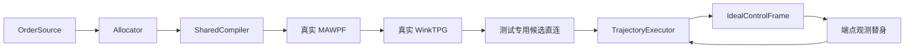

# 执行器与订单到控制帧重放

[中文](../../zh/development/0018-executor-replay.md) | [English](../../en/development/0018-executor-replay.md)

<!-- doc-sync: executor-replay / 2026-11-16-r1 -->

## 范围与来源

PR #17 已确认合并至 `08da31c442a79fa1d377c7b69cebeb72f992e67a`, 新分支 `feat/executor-replay` 从该基线创建. 用户目标更新为优先尽快展示端到端运行; 本 PR 将该偏好写入 AGENTS.md, 路线图和日志, 并连接此前已有的真实规划链与新增中央执行器.

规范: 用户原件 API 0.7 的 Section 10 和英文类型说明. 上游仍为 MAWPF `0cdb8e43797aff3781e4cd3ddb2c6d7d36f3df17` 与 WinkTPG `dd96946f225e206de35b041320786eab43210658`, URL, 许可证与构建见 [原生链日志](0009-staged-pipeline.md). 本次不修改原生代码, 不分发 WinkTPG 源码.

## 实现与边界

`execution.TrajectoryExecutor` 实现统一契约的 CentralExecutor.build_frame. 输入为 ExecutionInput 和 dt_s, 输出为 IdealControlFrame 或 Failure. 新依赖为 execution -> contracts, execution -> trajectory 与 execution -> validation, 架构检查同步更新. 后端与 Runtime 不实现.

执行器复用 PreparedTrajectory, evaluate 和 slice_curve, 按当前曲线缓存快照, 不再插值或重规划. 每帧保留两端和内部节点, 静止终点可继续保持. 执行边界校验集中在 execution/_validation.py, 曲线结构检查复用公开的 validation.check_motion_curve, 停车结构检查也使用同一实现. 拒绝缺车, 重复 ID, 非有限节点或时间, 空曲线, 非递增时间, 移动终点外推和起点状态不一致.

动作引用经已接受动作表解析, 只输出当前步开始且未运行的动作. 拒绝未知或重复引用, 无效耗时, 步中启动, 同车多启动和已忙机器人启动其他动作. 动作时钟比较容差为 min(1 ns, dt_s * 1e-6), 用于浮点累加误差; 位姿和速度衔接仍严格相等. 执行器不提交状态, 调用方每步只发送一个返回帧; 重复构帧是重建相同输出, 不等于后端已去重.



本次真实运行证据限于一车一架向东单车道. 观测替身只回送控制帧末位姿和速度, 不生成完成事件, 不改变货架或业务账本. 候选直连只在测试驱动存在, 不能用于生产接受. Runtime 接受, 动作完成, 货架效果, 账本更新, 后端, 连续碰撞与无限期停车安全仍未验证. 这不是完成订单的完整仓库闭环.

## 实际重放与验证

真实运行产生 91 帧, 0.0 到约 9.1 s. Lift, Serve, Drop 各启动一次, 分别约为 2.0, 5.2, 8.4 s. 最终机器人 x=5 m, 速度为零, 并继续发送静止保持. JSON 保留每步输入和输出, 动作启动, 原生程序文件, 二进制 SHA256 与上游版本. HTML 展示同一 JSON 的单步位置, 内部节点和动作.

```bash
PYTHONPATH=src:tests /tmp/trajectory-cpp-dev/bin/python -m execution.replay /tmp/tapf-chain-bridges --output /tmp/executor-native.json --html /tmp/executor-native.html
PYTHONPATH=src WAREHOUSE_NATIVE_BIN=/tmp/tapf-chain-bridges /tmp/trajectory-cpp-dev/bin/python -m unittest discover -s tests -q
/tmp/warehouse-ci-check/bin/ruff check src tests
```

TDD: 先因缺少 TrajectoryExecutor 导入失败. 9 项执行器测试与 1 项真实重放测试通过. 全套 123 项: 122 通过, 1 项可选 CBS-TA 跳过. Ruff 和 diff 检查通过. CI 配置新增 execution.json/html 产物, 远端结果待确认.

失败记录: 首次真实重放在 tick=3 因替身舍入时间与曲线端点时间不一致而拒绝; 改用返回帧的 to_s. 另一个回归测试先得到动作数量 `0 != 1`, 暴露 `0.1 + 0.2` 与 `0.3` 的动作时钟比较错误; 加入明确的小时钟容差后通过. 不放宽位姿校验. 首次浏览器脚本使用内建 append 作事件回调失败, 改为显式回调. 手机动作 JSON 导致文本溢出, 改为可换行简短动作标签; 原始数据保留于详情.

## PR 与下一步

当前 PR 待创建. 合并前只处理本 PR 审查. 下一步按用户端到端优先级选择最小闭环缺口, 不在本 PR 实现 Runtime 或后端. 私有进展页与实际重放将同步发布, 不改变访问权限.

补充验证: 干净目录 `/tmp/executor-wheel-ro4ojnsr` 重建 wheel 并安装后, 隔离测试同为 123 项, 122 通过, 1 跳过, pip check 通过. 真实原生程序复用已有固定版本二进制, SHA256 在 JSON 中, 本次不声称重新构建上游. 双语进展页和重放页均通过桌面, 手机与键盘检查, 已检查截图. 可从进展页进入 [实际单步重放](https://warehouse-planning-observatory.gain-salvo-0t.chatgpt.site/execution-replay.html). 发布时将本次生成的 HTML 作为证据加入独立 Sites checkout; 原始源码模板在 tests/execution/replay.html 审查, 不把生成数据计为新的算法实现.
