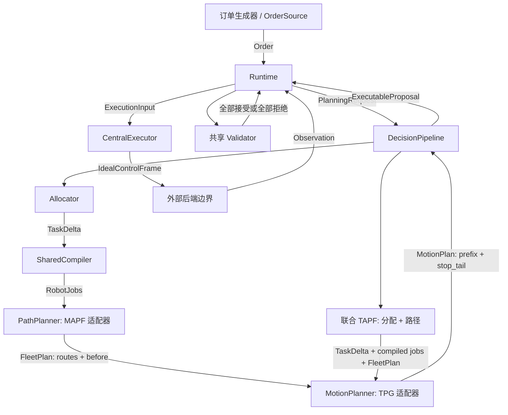

# 开发计划

[中文](../../zh/development/ROADMAP.md) | [English](../../en/development/ROADMAP.md)

<!-- doc-sync: roadmap / 2026-10-19-r6 -->

状态: PR #3 已合并至 `b310d6a`. 阶段 3 订单源与带 seed 的生成器已实现.
阶段 4 共用动作耗时函数已实现并通过本地测试, 等待 review; 编译器其余部分
及阶段 5-11 仍为计划. 证据与限制见 [耗时日志](0004-action-durations.md).
每个阶段可能需要多个 PR. 每个 PR 的代码变更不超过 500 行,
文档和配置不计入. 用户合并后才能开发下一步. 中英文同步更新.

## 可替换模块

图中描述目标设计, 尚未完成真实集成. 后端位于本次工作范围之外.
测试可提供固定观测和替身. 通过构造函数注入选择实现.
新增算法不应要求改动 Runtime 或公开请求字段. 原生依赖保持可选.

`DecisionPipeline.solve(PlanningRequest)` 是统一替换边界.
分阶段实现组合分配器, 编译器, MAPF 和运动规划器.
联合 TAPF 同时替换分配和路径搜索, 然后使用相同的编译语义,
运动适配器, 验证器和最终提交. 同时优化运动的求解器也可直接实现整个边界.
不要增加强制中间提交, 也不要声称 TAPF 已处理仓库库存.

## 分批阶段与验收证据

| 阶段 | 范围 | 标记为已实现前需要的证据 |
| --- | --- | --- |
| 1 | 共享 API 契约, 包, review 规则 | 独立安装与导入; 原件哈希 |
| 2 | 结构 codec 和选定 fixture | 往返转换; 拒绝未知字段和无效值 |
| 3 | 订单源与带 seed 的订单生成 | 有序发布, 合并 SKU, 不重复发布, 拒绝时间倒退, reset 重放 |
| 4 | 共享任务编译器 | 可变后缀编辑, D1 锁, 携带归属, 共用量化耗时 |
| 5 | 分配适配器 | 库存与需求可行, 稳定任务 ID, 输入快照不变 |
| 6 | MAPF 进程适配器 | 真实固定版本可执行文件, 相邻边, 重复资源访问, 完整先后关系, 超时 |
| 7 | TPG 进程适配器 | 真实速度曲线, 精确拼接, 动作耗时, 全车队停车尾段, 明确不支持的情况 |
| 8 | 分阶段与联合 TAPF 组合 | 在同一受支持 fixture 上用 CBS-TA 替换独立分配/MAPF |
| 9 | 连续验证器 | 采样间交叉, 跟随, 载货转弯, 资源容量, 无限期终点占用 |
| 10 | Runtime 事务与分支 | 不重复预留, 幂等提交, 拒绝过期结果, 保护 Lift, 到期分支优先 |
| 11 | 中央执行器与集成重放 | 精确 Hermite 切片, 保留切换节点, 动作只启动一次, 事件去重 |

集成上游前先定义并测试适配器支持的子集.
不支持的边中间起步, 载货交接, 几何, 循环旋转或动作语义必须明确拒绝,
不能默默简化问题. 中间适配器 PR 不必声称所有阶段均可运行.
共享验证器和停车要求满足之前, 不接受任何可执行方案.

## 上游候选

检查日期为 2026-10-19. 以下是调研候选, 尚未通过集成验证.

| 候选 | 证据与建议用途 | 适配工作 / 限制 |
| --- | --- | --- |
| [MAWPF](https://github.com/HirokiNagai-39/mawpf) | C++17; CLI 可选 LaCAM, PIBT, LNS2 或 PP; MIT | 首个 MAPF 系列. 转换图/状态/任务, 展开跨格移动, 导出资源先后关系. 仓库动作需检查支持能力. |
| [WinkTPG](https://github.com/JingtianYan/WinkTPG-IEEE-TASE) | C++20 和 Boost; 路径文件输入, CSV 输出; 模式 1 为 WinkTPG, 0 为 TPG | 首个运动规划系列. 补充物理动作, 精确拼接和全车队停车检查. 检查的文件树中未发现许可证文件; 再分发前需明确使用条款. |
| [libMultiRobotPlanning](https://github.com/whoenig/libMultiRobotPlanning) | C++14; CBS/ECBS, CBS-TA/ECBS-TA, 最小费用分配与次优分配枚举; MIT | 分配和联合 TAPF 实验. 目标分配示例不表达 SKU 选择, 货架服务或队列锁. |

检查的 commits (引入构建时再次固定):

- MAWPF: `0cdb8e43797aff3781e4cd3ddb2c6d7d36f3df17`.
- WinkTPG: `dd96946f225e206de35b041320786eab43210658`.
- libMultiRobotPlanning: `4c75fa20c435c440d8b6bd6dc81668ddc7296ba0`.

分配先测试具有明确可行边的最小费用机器人/任务匹配.
仓库专用代码仍需选择可行货架, 拣选项, 工作站和归还位置.
匹配本身不解决库存或服务顺序.
先在每个机器人一个目标的受限场景中与联合 CBS-TA 比较,
再扩展到多动作仓库任务. 这是计划中的实验, 不表示 CBS-TA 已支持完整 API.

## 可观察性

每次真实集成运行记录请求 ID, 输入 fixture, 上游 commit, 命令/配置,
seed, 墙钟预算, 退出状态, 诊断和归一化结果.
修复时保留最小失败重放. 追踪分配, 路线访问/先后关系, 运动节点和停车决策.
有真实求解器输出可检查时再增加重放界面.
fixture 通过与原生求解器运行必须分别标注.
